<div align="center">



</div>

### Every number on that receipt is real. Check it.

A [GitHub Action](.github/workflows/receipt.yml) reprints the receipt every day from the GitHub API. It saves the raw numbers to [`receipt/data.json`](receipt/data.json) and prints that file's SHA-256 at the bottom of the receipt. To check that the two match:

```sh
curl -s https://raw.githubusercontent.com/Ritesh-Root/Ritesh-Root/main/receipt/data.json | sha256sum
```

If the hashes don't match, the receipt is wrong. If they're only out of sync for a few minutes, that's GitHub's image cache.

### Hi, I'm Ritesh 👋

I'm a BTech CSE student who builds at hackathons, mostly AI agents that have to show their work. The common thread: an AI shouldn't get to say *"done"* unless it has a receipt to back it up, like a signed check, a hash-chained log, a quote from the source, or a human approval.

### Itemised

| | Project | What it does |
|---|---|---|
| 🧾 | [**switch-notary**](https://github.com/Ritesh-Root/switch-notary) | Checks every claim AI coworkers make against git, its own test re-run and the tool log, then issues a signed receipt. Rust. |
| 🏥 | [**aarogya-vayu**](https://github.com/Ritesh-Root/aarogya-vayu) · [live](https://aarogya-vayu.vercel.app) | Moves medicine to rural clinics before smog or heat empties their shelves. Hash-chained audit log, a doctor approves every transfer. **Top 10, Google Code for Communities.** |
| 🍽️ | [**agora-taste-council**](https://github.com/Ritesh-Root/agora-taste-council) · [live](https://agora-plus-295478535981.us-central1.run.app) | Picks what the whole family will enjoy. Qloo's taste graph + maximin, so nobody is left out. |
| 🧮 | [**taxeasy**](https://github.com/Ritesh-Root/taxeasy) | A CA on WhatsApp for Indian small businesses: GST, bills, tax. |
| 🔬 | [**neural-lens**](https://github.com/Ritesh-Root/neural-lens) | Six hands-on x-ray labs that show what goes on inside an AI. |
| 🕯️ | [**ofrenda**](https://github.com/Ritesh-Root/ofrenda) | An altar that answers only with what your family remembers, and keeps both versions when they disagree. |
| 👆 | [**pulsepay-paypal**](https://github.com/Ritesh-Root/pulsepay-paypal) | Pay at any shop with a fingerprint or face plus a PIN. |
| ⏸️ | [**hold**](https://github.com/Ritesh-Root/hold) | A household agent that shows the plan, waits, then does it. Rust + MCP. |

### Find me

[](https://riteshhoon.online) [](https://www.linkedin.com/in/riteshhoon) [](https://x.com/riteshhoon) [](https://instagram.com/riteshhoon) [](https://reddit.com/user/riteshhoon) [](https://discord.gg/3BNhUEtZ) [](https://codepen.io/Ritesh-Mahato) [](mailto:riteshmahatowork@gmail.com)

<details>
<summary><b>The full tool shelf</b></summary>
<br>

                           

</details>

<sub>Want to change what's on the receipt? The line items are in [`receipt/items.json`](receipt/items.json), and the printer is [`scripts/build_receipt.py`](scripts/build_receipt.py) (Python standard library only).</sub>
